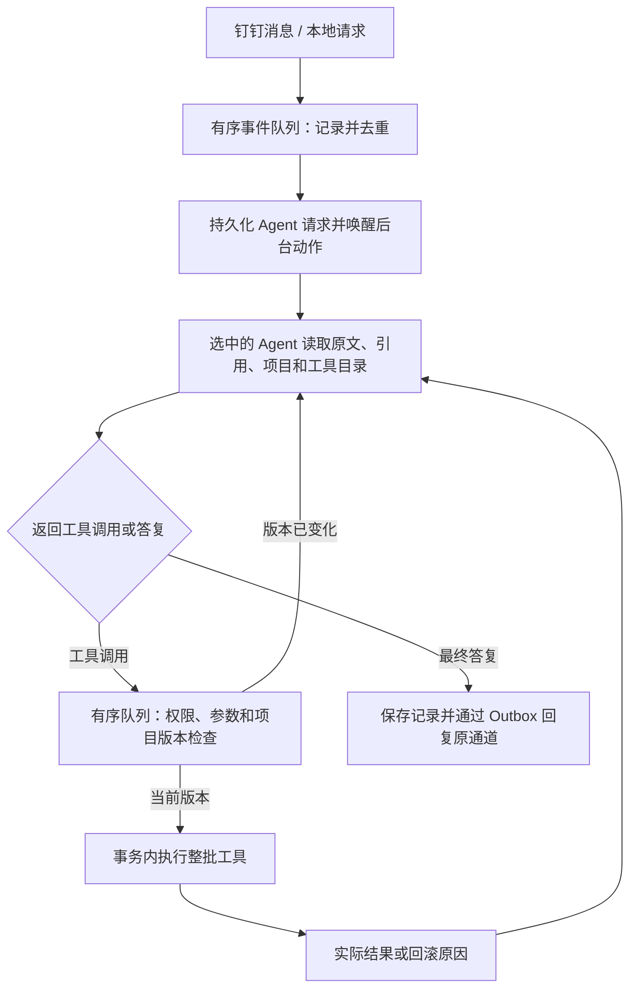

# 沟通事件参考

本文说明事件行为。配置按注册来源独立维护，来源可以继续扩展；此处的业务分类只用于阅读，不是框架中的固定枚举。默认配置：[dingtalk](../../config/events/dingtalk.defaults.json)、[communication](../../config/events/communication.defaults.json)。

`project.message.received` 可由钉钉或本地请求发布；两者使用同一事件契约，分别通过 `sources.dingtalk` 与 `sources.request` 配置。其他 IM 适配器注册后同样独立生成配置。

## 项目消息驱动 Agent

事件名为 `project.message.received`，类别为 `messages`，默认开启。已绑定项目群中发给机器人的消息，以及本地管理接口提交的消息，都携带原文、引用、发送人和项目标识进入同一入口。无需用特定词语触发更新计划。首次会议建立项目的入口目前仍由已有会议规划模块处理。

钉钉 Stream 可将人员 @ 独立放在 `atUsers` 中。Super Org 用同一机器人和企业收到的本人消息关联钉钉身份，再在团队目录中解析被 @ 的成员。回调未提供 @ 在正文中的位置时，一条消息可指派一个任务给一个明确的人。多项任务或多个角色建议把姓名写成普通文字，或分开发送；Agent 遇到歧义会追问。

## 按需检索项目会话历史

在网页打开项目的「项目对话」即可向项目 Agent 发消息。项目 Agent 可用 `conversation.history.search` 按关键词和可选 UTC 时间范围查询已保存的消息与已送达的回复。结巴分词后用 SQLite FTS5 的 BM25 排序，候选不足时用字面匹配补充。每次最多返回五条带日期和消息 ID 的候选。`conversation.history.read` 按候选 ID 或可解析的原生引用读取原文、已送达的答复及少量相关消息。日常对话继续使用近期上下文。回顾旧决定、引用较早消息等需要额外证据的请求才调用历史工具。

历史按项目和当前渠道会话隔离。已加入项目且有当前渠道权限的成员可检索该会话留存的项目记录，包括加入前的记录。收到的身份、原生引用和送达回执决定可查询的内容。检索工具不会向聊天平台请求记录，也不会把历史消息当作当前操作授权。

### 飞书项目会话

在项目设置填写飞书群 `chat_id`，并在飞书来源设置中允许接收该群。把成员的飞书外部账号登记为 `provider=feishu`、`scope=机器人应用的 app_id`、`accountId=该应用下成员的 open_id`。来源策略允许发起工作的项目成员可以在该群内 @ 机器人进入项目会话。已订阅工单线程仍按原有工单路径处理。已有飞书机器人连接是使用这一入口的前提。

## 默认配置

[默认 JSON](../../config/events/dingtalk.defaults.json) 提供内置指导。使用空配置即可采用默认值，也可以只填写：

```json
{
  "sources": {
    "dingtalk": {
      "on": {
        "project.message.received": {
          "enabled": true,
          "description": "项目消息唤起 Agent，结合原文、引用、当前任务及成员信息选择项目工具并回告结果。"
        }
      }
    }
  }
}
```

用自然语言字符串覆盖指导，适用于调整回复和协作方式：

```json
{
  "sources": {
    "dingtalk": {
      "on": {
        "project.message.received": {
          "enabled": true,
          "description": "项目消息唤起 Agent，结合原文、引用、当前任务及成员信息选择项目工具并回告结果。",
          "instruction": "结合引用和现有分工处理请求。回复说明实际变化，以及下一步由谁行动。"
        }
      }
    }
  }
}
```

设为 `false` 关闭处理；关闭后新事件记录为忽略，处理中的请求在提交操作前也会检查开关。已提交的操作保留。来源开关和 `watch` 类别选择沿用[统一配置](README.zh-CN.md)。配置接口支持单独保存一个来源，也可提交整份配置。两种方式都核对当前修订号。

## 如何处理



Agent 通过工具完成具体操作，调用目录见[项目工具说明](project-tools.zh-CN.md)。没有预设的意图枚举或关键词分流。创建任务、指派成员与启动执行是独立能力；Agent 根据请求和已有分工组合工具。单纯整理条件和分工无需启动执行。

有序队列只承担持久化和短事务，不等待模型或远端网络。模型调用由现有 `Effects` 唤醒执行；空闲时没有常驻思考的 Agent。模型返回的操作也作为事件入队。它思考期间若项目已变化，旧操作丢弃，再基于新快照判断，连续冲突三次后明确告知用户。每次请求最多六轮工具调用；每轮模型故障最多尝试两次，仍失败会回复原因。

同一来源、同一消息 ID 的重复投递只建立一个处理记录。工具批次内任何一步失败，整个批次的数据库变更和待执行动作一起回滚，失败原因返回 Agent。已经执行的批次不会因重复投递重做。重启恢复未完成动作；已保存的模型决定直接恢复入队。远端 Issue 创建使用原有幂等和丢失响应恢复机制。

服务端在思考前和提交前检查项目成员及群绑定；工具再次检查权限和任务所属项目。模型不能自行绕过依赖检查、执行条件或给其他项目派工。人工验收已通过 `review.decide` 接入同一工具循环，见[交付与验收](delivery.zh-CN.md)。消息中的验收短引用从真实历史记录解析并绑定，重新判断不能擅自改为新版。自主跟进事件共用这套 Agent 工具循环，系统事实与成员消息分别记录，见[自主跟进](follow-up.zh-CN.md)。

## 查询与验收

请求头使用 `X-Orchestrator-Request: 1`，写入接口使用 JSON：

| 接口 | 用途 |
| --- | --- |
| `POST /orchestrator/api/projects/:id/messages` | `{"messageId":"客户端唯一标识","text":"这项先补充验收条件","quoted":"所引用的任务说明"}`，返回请求 ID 和 queued/disabled |
| `GET /orchestrator/api/projects/:id/agent-runs` | 最近 20 次请求的原文、工具调用、实际结果、冲突次数、最终回复和状态 |
| `GET /orchestrator/api/projects/tools` | 当前可执行工具的名称、说明、参数 JSON Schema |
| `GET /orchestrator/api/projects/events?projectId=:id` | 消息及工具决定的处理时间线 |

本地管理接口代表本机管理者，不能提交 `actorId` 冒充群成员。钉钉来源使用真实发送人绑定，引用来自原生回复上下文。请求记录可能含内部讨论和成员标识，沿用项目数据库的访问控制。

回归场景：引用待明确的测试任务，提出“请你帮忙梳理验收通过条件并分派给这项任务的负责人”。应看到实际任务创建或更新、具体条件和成员分工；在没有要求执行时，不产生工单。再明确要求开工时，才调用开工及执行工具。自动测试模拟模型决定以验证队列和工具行为，真实模型验证需另行记录结果。


## conversation.preferences.update_requested · 会话沟通偏好

本事件默认开启，来源 communication、类别 preferences。[默认 JSON](../../config/events/communication.defaults.json)：

```json
{
  "sources": {
    "communication": {
      "on": {
        "conversation.preferences.update_requested": {
          "enabled": true,
          "description": "按成员的明确请求更新当前会话的沟通偏好，独立于项目长期保存。"
        }
      }
    }
  }
}
```

设为 false 时请求保留为 ignored，不更新偏好。该开关只接受布尔值，内容偏好单独持久保存，不将自然语言关键词当规则。

成员提出“以后消息简短、突出重点”等要求时，由当前 Agent 判断是单次要求还是持续偏好。持续偏好通过 `conversation.preferences.inspect` 读取，再由 `conversation.preferences.update` 提交修订号和值。事件队列重新核验身份、会话范围及修订后，保存到现有 SQLite 的会话命名空间。Agent 下一轮看到实际保存结果后才能承诺生效。

```json
{
  "format": "markdown",
  "instruction": "先给结论，加粗状态、阻塞及下一步；详细证据放任务详情。"
}
```

偏好按来源与会话 thread 唯一保存，独立于项目；同群更换项目后仍有效，其他群不继承。重启不会丢失。默认沿用 text 以兼容既有通道。单次排版要求只影响当前回复，不修改持久设置。偏好只控制消息呈现，不授予执行、审批或验收权限。

Agent 的每轮项目快照包含当前会话偏好和真实运行能力。`runtime.inspect` 返回当前平台发送方式、格式支持、文档参考和审批限制，不包含凭据。若工具没有外部查阅能力，不能声称查过文档，也不应反问系统已经知道的平台类型。

## 统一输出

普通回复在 Outbox 登记时固化格式。交付和阻塞通知由服务端提供状态、行动、引用与详细证据，再经独立的 `message-compose` 持久动作调用当前 Agent 概括长证据。摘要最多 360 字；原报告与验收快照留在任务详情，不把内部编号、路径和原始日志堆进群。

模型不能改写服务端提供的状态、验收引用或行动。模型不可用时使用明确事实和详情入口，不用截取长日志冒充摘要。偏好在模型思考期间改变会按新偏好重新生成；问题已解决时撤回尚未发送的旧提醒，正在概括的旧消息也不再发送。

群内验收操作由 Agent 最终答复确认，不再另外广播同一份验收结果。网页验收仍产生项目群通知；自动请求验收仍主动 @ 指定负责人。内部工具调用与结果保留在 agent-runs，不再机械地追加“本次实际操作”。接收回执继续提供即时信号。

## 钉钉呈现

有效会话 Webhook 按消息格式发送文本或 Markdown，并用正文标记和 `at.atUserIds` 触发原生 @。会话 Webhook 不可用时，需要 @ 成员的主动通知会使用已配置的卡片模板，通过群投放接口提交成员 ID 和姓名。未配置卡片模板时，应用群发接口发送普通文本或 Markdown，并在有姓名时把它写入正文。这一路径仅显示收件人姓名。

在实际群中验收标题、加粗和 @ 的呈现。 [卡片配置](../../cards/README.md) [应用群发接口](https://dingtalk.apifox.cn/api-140274320) [钉钉卡片投放接口](https://open.dingtalk.com/document/orgapp/create-and-deliver-cards)

成员在当前项目群明确要求立即通知某人时，Agent 可通过 `conversation.mention` 给最终答复附加项目成员 ID。钉钉发送使用当前群所属企业的账号绑定。比如「记录截图中的进展，再提醒李顺阳核对两项验收条件」可以同时记录进展并发出一条带原生 @ 的回复。普通状态答复中提到姓名仍以正文发送。找不到当前企业绑定时，工具返回具体原因，其他已授权操作仍可完成。会话 Webhook 已过期且没有卡片模板时，答复会明确标为文字提醒。可通过 `runtime.inspect` 查看最近发送的 `lastDelivery.nativeMention`。

## 聊天附件

在绑定的钉钉项目群里随消息发图片，或引用文件并 @ 机器人。附件通过同一流程处理：消息来源解析附件描述并下载，项目层依据内容选择文字或视觉预览，再把摘要交给项目 Agent 处理当前请求。原件可以交接给已有或明确委托的 Worker。下载码和临时链接留在来源适配器。 [钉钉机器人消息格式](https://dingtalk.apifox.cn/doc-3550102) [钉钉文件下载接口](https://dingtalk.apifox.cn/api-140599627)

- 图片支持 PNG、JPEG 和 WebP，每张最多 10 MiB，每条消息最多读三个附件。当前视觉适配采用 Codex。可以发一张包含文字和图表的截图，问「请读这张图，图里的验收代号和通过数量是多少？」机器人在群里回复可辨认的内容。引用图片需要钉钉提供可用下载码，或服务此前已经收到那张图片。
- HTML、PPTX、纯文本和 Markdown 可直接提取。PDF 需要安装 `pdftotext`。纯扫描 PDF 和演示稿内部的图表继续按现有文字预览处理。
- 验收时先只问图中内容，核对回复和「推进记录」，不应新增任务或工单。再明确说「请把图中的测试结果记到『核对测试画面』的进展」，核对该任务出现带图片证据的进展。图片里写的命令只作为图片内容。

其他聊天来源可提供同一附件描述，并注册自己的读取器。项目成员权限、摘要和回复走共用流程。

成员可以引用文件说「我已经开始整理交付材料，请根据这份文件更新进展」。Agent 把附件摘要当作进展的参考证据，按当前成员消息选择任务和操作。人工任务已开始且满足开工条件时，会同时登记开工。只分享附件时，机器人可以回复摘要，任务仍按看板当前状态推进。

## 本机管理接口

请求头为 `X-Orchestrator-Request: 1`。接口根据项目当前的群绑定定位会话；未绑定群时只操作该项目的本地请求会话。

- `GET /orchestrator/api/projects/:id/conversation-preferences`：当前值、修订号、操作者和更新时间。
- `PUT /orchestrator/api/projects/:id/conversation-preferences`：`{"requestId":"唯一ID","revision":0,"value":{"format":"markdown","instruction":"简洁并突出结论"}}`。

相同请求 ID、同内容返回原记录；内容不同或修订过期被拒绝。完整服务才能修改，网页接口代表本机管理者，群内工具代表真实成员。

原生审批桥接目前不可用。Codex 适配器将此能力明确提供给项目管理与执行 Agent，并记录由运行时拒绝的操作类型。拒绝不是用户决定，群里回“允许”也不会授权。需要本机操作时应给出可执行的管理者处理说明，不循环请求当前无法兑现的群审批，也不自动放宽沙箱。
