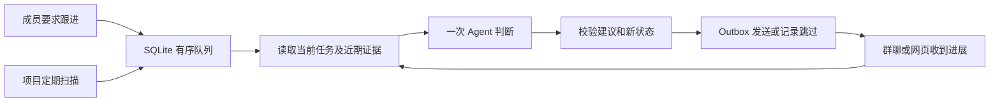

# Super-Org 任务进展与自动追踪提案

项目定期取一次任务现状，由 Agent 判断现在是否值得跟进。成员也可以主动要求跟进，两种触发共用一条链路。项目配置和操作见[任务进展与跟进](../events/task-tracking.zh-CN.md)。

## 1. 用 2048 跑一遍

项目配置在工作日 10:00 和 16:00 检查。C「人工试玩」由成员丙负责，内容包括键盘、重开和触屏。自动派工关闭，项目仍可启用追踪。

| 时间 | 系统读到了什么 | 预期结果 |
| --- | --- | --- |
| 10:00 例行检查 | B 还待验收，C 需要可玩的版本才能完成实机测试。任务已有键盘、重开和触屏的验收条件 | Agent 根据已有条件向丙问：「试玩版本就绪前，可以先准备键盘和触屏用例。测试设备和用例确认了吗？剩下哪一步要等 B？」 |
| 10:20 | 丙在网页登记「已整理五项用例，确认 Chrome 和 iPhone Safari；跑用例还缺试玩链接」 | C 有一条实质进展，保留真实作者和来源。依赖 B 仍清楚可见 |
| 11:30 | B 的验收通过，可玩的版本已可用 | 丙能按已准备好的用例实测。下一次检查仍是项目原定的 16:00 |
| 16:00 例行检查 | C 已登记准备结果，且上午已经发过一次跟进 | 模型能读到用例、设备和上次提醒。本轮保持安静，不重复催丙 |

另一个入口是在 B 仍待验收时，成员甲发消息：「请跟一下 C 的触屏试玩，看看版本就绪前能准备哪些。」系统可以当时检查 C 并发问。下次例行检查仍会读到 C、已有准备和发送结果。相同任务在建议的冷却期内最多登记一次同类提醒。

## 2. 需要做的三件事

| 功能 | 规则 | 校验方式 |
| --- | --- | --- |
| **每个任务可以记进展** | 网页任务详情可以追加进展，群聊可以由 Agent 从明确指代的消息中登记。记录实际结果、可选的卡点和证据，以及真实作者、时间和来源。任务无需有负责人或启用追踪 | 人工、Agent 和未分派任务都能保存进展。重复投递只保存一次。记录进展后仍使用原来的交付和验收状态 |
| **按项目定期取现状** | 每个项目只维护一个时间表。扫描读取未完成任务及近期事实，也覆盖待依赖、待验收和排队的任务 | 同一时点重投或重启最多登记一次扫描。依赖未完成时，模型仍能针对可并行的准备提问 |
| **Agent 提议，系统把关** | 同一轮检查把任务事实交给一次模型判断。候选包含任务 ID、已存在的证据引用、理由和要问的问题。没有合适的跟进可返回空数组 | 模型建议只获得登记提醒的权限。发送前按真实身份、当前状态和历史回执再核对。推进记录显示发送、跳过或失败的实际结果 |

任务详情的进展是追加记录。前端可从「记录进展」提交文字和证据链接。群聊继续使用当前 IM 适配器的身份和引用解析。工作台与群聊调用同一个 `progress.record`。执行 Agent 的既有工单报告和关联仓库事实作为可读证据，继续走现有入口。授权成员可以更正自己报告的内容，历史保留前后来源。

「当前在等什么」直接读任务、当前验收和工单。例如 A 的第 1 版待验收，或 B 的当前工单待答问题。看板显示实际对象和责任人。第 1 版通过后，旧等待从当前列表消失。工单收到答复后，在 Worker 清除问题之前显示「答复已提交」。这些已有状态足以作为扫描素材。

## 3. 只有两种跟进触发

| 事件 | 如何注入 | 检查范围 |
| --- | --- | --- |
| `tracking.ping.requested` | 当前项目成员在群里明确要求跟进。现有项目 Agent 解释消息、确认任务后登记。网页「跟进进展」可以提交同一操作 | 用户指定的任务。单纯查状态直接回答，歧义时请人确认任务 |
| `tracking.check.due` | 时钟根据项目时间表发布，携带项目 ID 和预定时点。事件 ID 由项目与时点确定 | 项目里的未完成任务。暂停、归档或未启用追踪的项目不启动分析 |



自动触发复用现有 SQLite 事件队列和 Effects。每个到期事件只登记一个分析作业。模型调用在事务外执行，共用当前项目 Agent 的 `ProjectPlanner.propose` 和结构化输出校验。项目级扫描用只读分析作业收集建议，保留现有任务事件处理器的权限范围。手工触发调用同一个分析与投递服务，输入范围限于所指的任务。 [事件队列](../../src/app/project-events.ts) · [时间表和分析](../../src/app/project-tracking.ts) · [模型接口](../../src/app/project-planning.ts)

重启恢复已登记的事件和作业。同一项目、同一计划时点只登记一个逻辑扫描。离线期间错过多个时点，恢复后最多补查一次当前现状，然后回到原时间表。

## 4. Agent 看到什么，怎么判断

每个任务给出一份短快照：标题和目标、验收条件、当前负责人及状态、截止时间、每项依赖的交付和状态、近期进展、当前工单报告或验收、最近一次跟进及实际发送结果。保留引用，供模型在建议中指出依据。缺少某项数据时明确显示未知。例如有 GitHub 提交只证明代码有变动，触屏测试仍需相关结果。

模型只需回答：**现在问谁、问哪一个具体问题，为什么此时值得问？** 对等待依赖的任务，先区分哪一步要等、哪些准备或检查可以继续。看得到有价值的并行工作，就询问具体结果或建议下一步；已有准备进展时，把它作为事实读入。当前步骤确实只能等待时，指出缺少的交付或决定，并结合整个项目判断是否该跟进上游。准备已完成、上游正在处理且近期已经问过时，可以保持安静。发现多个候选时，结合真实截止、影响和已有消息选择优先项。

需要上游产物的执行和交付步骤继续受依赖约束。等待期间的用例、调研或设备准备都可记在原任务里。例行扫描跟进上游时，建议指向上游任务，由系统解析该任务的负责人。跟进提案只能登记问题，派工、改依赖或改验收条件走已有的授权操作。

建议结构示例：

```json
{
  "suggestions": [
    {
      "taskId": "C",
      "recipientId": "member-c",
      "reason": "B 的试玩版本仍待验收，C 已有键盘和触屏验收条件，可以先准备设备和用例",
      "evidenceRefs": ["review-b-current", "task-c-acceptance"],
      "question": "键盘和触屏的测试用例、设备是否已准备？哪一步必须等到试玩链接可用？"
    }
  ]
}
```

模型结果是提案。项目层校验任务、收件人与证据均属于此次快照，按成员的真实群账号登记投递。待答复工单的候选收件人来自该工单原文明确点名的可唯一匹配成员，Agent 需要引用工单，验收人要等交付提交后才进入待验收阶段。紧急情况由真实日期、依赖和已确认决定提供上下文，模型负责排序和选择问题。固定扫描间隔决定自动发现的速度。两次扫描之间需要尽快处理时，成员可以主动触发。

## 5. 发送与恢复只留必要约束

1. **发前再核对。** 任务仍有效、当前负责人及群绑定匹配，且快照之后没有新进展、验收或相关状态变化。状态已变就放弃本次提案，下次按新事实判断。成员发起时也核对其项目权限。
2. **控制数量。** 试点每次自动扫描最多发一条，发送前检查项目工作时段。建议同一任务在 24 小时内最多登记一次提醒；人工和自动分别记录触发原因，共用这条去重限制。同一动作重试使用稳定的 Outbox 投递 ID。模型失败或渠道不可用时，推进记录可查原因，看板仍展示需处理的事项。
3. **保存实际结果。** 收到群消息、登记进展和平台接受提醒是不同结果。网页和群回复都写回同一任务。发送已经开始或平台已接受时保留真实回执。平台请求超时可能无法确认物理消息是否重复，投递记录应保留这种不确定性。

## 6. 两条端到端验收

使用独立 SQLite、假时钟和模拟 DingTalk 回调。让真实的消息解析、项目事件、任务更新和 Outbox 运行。用测试替身提供模型输出及出站 HTTP。测试不读取本机 `.env`，不启用真实机器人。 [现有 Mock 回调示例](../../tests/dingtalk-cards.spec.ts)

| 闭环 | 操作 | 明确断言 |
| --- | --- | --- |
| **消息触发** | B 仍待验收，14:00 向 Mock 群注入「请跟一下 C，看版本就绪前能准备哪些」。丙经同一模拟入口回复设备和用例。推进到 16:00 | 一个成员发起的追踪事件。外发一次且正确指向丙。回复写入 C，作者和原文可查。16:00 再扫时看见准备和已发回执，外发为零 |
| **自动触发** | 群里零入站，10:00 扫描时 B 待验收、C 没有准备记录，模型建议先核对设备和用例。丙从网页记下准备结果。16:00 再扫描 | 10:00 从项目时钟产生一个事件，模型快照包含仍在等待依赖的 C，Outbox 发 1 条。网页进展正确写回 C，依赖仍指向 B。16:00 读取已确认的准备结果，外发为零。C 的业务状态与派工设置保持原样 |

两条用例共用校验条件：重复时点或重启不重复登记，人工与自动相邻触发时近期同一任务只提醒一次，发送前新增证据会撤销旧建议，其他群或无权成员不能提交动作。用同一份自动扫描夹具替换两种输入，核对模型判断依据：已有并行准备时不重复要求，明确无后续准备且上游仍缺关键交付时能指出上游对象。另以领域工具验证所有任务都可选填进展。

实施顺序是先落地进展记录，再接两个事件和共用分析，最后核对发前校验、回执及这两条验收。判断质量主要检验 Agent 有没有基于可追溯证据问出有用的问题，服务端测试负责稳定校验权限、持久化和发送次数。
